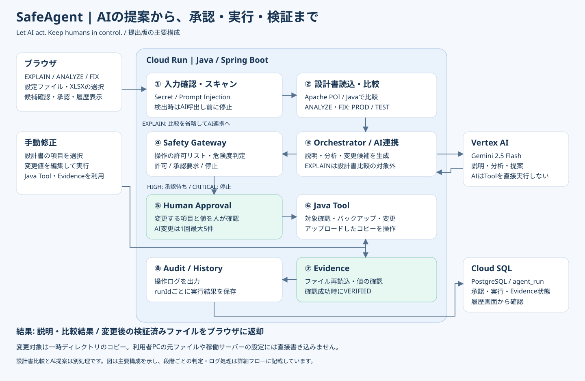

# SafeAgent

**Let AI act. Keep humans in control.**

設定ファイルの説明・設計書との比較・修正提案を、承認と実行後の検証につなげるAIエージェントです。Java / Spring Bootで、AIの提案からSafety Gateway、Human Approval、Tool実行、Evidence、履歴保存までを実装しています。

**[公開デモ](https://safeagent-72ldcuhdwq-an.a.run.app/)** · **[ソースコード](https://github.com/maposuone/safeagent)** · **[アーキテクチャ詳細](docs/architecture.md)**

## 解決したい課題

設定ファイルの確認では、設定の意味を理解し、定数設計書との差異を調べ、変更の影響を判断する必要があります。AIの説明や提案だけでは、実際に何を変更したか、変更が成功したかを確認できません。

SafeAgentは、この流れを一つの画面から進め、変更前の人の判断と変更後のファイル確認を組み合わせます。

## できること

| 確認モード | 入力 | 主な結果 | ファイル変更 |
| --- | --- | --- | --- |
| EXPLAIN | 設定ファイル | AIによる設定内容の説明。設計書比較は対象外 | なし |
| ANALYZE | 設定ファイル＋定数設計書（XLSX） | PROD / TESTの設計値との比較、差異表示、AIによる分析 | なし |
| FIX | 設定ファイル＋定数設計書（XLSX） | AIの変更候補、項目の選択・承認、実行後の検証 | 承認した項目を変更 |

- 設計書の全項目を確認し、修正できる項目を選ぶ手動修正画面。
- 実行履歴の表示と、承認・実行・Evidenceの状態記録。
- ファイル名不一致、ファイル読込、AI接続、DB処理などの日本語エラー表示。
- 確認モード切替時の入力・結果初期化、画面更新なしの連続実行。

対象はアップロードした設定ファイルのコピーです。稼働中のApacheやTomcatの設定を直接変更・再起動する機能ではありません。検証済みの変更内容をダウンロードして確認できます。

## アーキテクチャ



設計書との比較はJavaで行います。Geminiの分析・提案は別の処理であり、AI提案が設計値と一致するとは限りません。変更する項目と値を画面で確認してから承認します。

## 安全性を支える処理

| 処理 | 実装内容 |
| --- | --- |
| 入力スキャン | 設定ファイルのSecret / Prompt Injection検出。検出時はGemini呼出し前に停止 |
| Permission / Risk | 操作の許可リストと危険度をJavaで判定 |
| Safety Gateway | LOW / MEDIUMは許可、HIGHは承認要求、CRITICALや未知の操作は停止 |
| Human Approval | FIXの変更候補から実行する項目を選択。AI変更は1回最大5件 |
| Tool | Javaで対象位置を確認して変更。行指定・XML属性指定、バックアップ、パス制約を実装 |
| Evidence | 変更後のファイルを再読込し、対象値を確認。全項目の確認成功時にVERIFIED |
| Audit / History | 操作ログとPostgreSQLの実行履歴に結果を記録 |

`APPROVAL_REQUIRED`は変更の承認が必要な判定です。承認待ちでは変更Toolは実行されず、設定値は変わりません。読取・分析処理は先に実行されます。

## デモの確認手順

1. EXPLAINで`httpd.conf`を選び、設定の説明を確認します。比較結果は「EXPLAINでは定数設計書との比較は行いません。」になります。
2. ANALYZEで同じ設定ファイルと`定数設計書_httpd.xlsx`を選び、対象環境を指定して差異を確認します。
3. FIXで変更候補と変更後の値を確認します。承認前に設定値が変わらないことを確認します。
4. 変更する項目だけを選択して実行し、Evidenceとダウンロードしたファイルを確認します。
5. 履歴画面で同じrunIdの承認・実行結果を確認します。

モード切替でファイル選択も初期化されるため、切替後はファイルを再選択してください。公開デモには機密情報を含まないテストデータを使用してください。

### テストシナリオ

| データ区分 | 確認する内容 |
| --- | --- |
| 01_EXPLAIN | 設定ファイルのみの説明、比較対象外 |
| 02_ANALYZE_MATCH | 設計値との一致、変更なし |
| 03_ANALYZE_FIX_DIFF | 差異検出 → 候補確認 → 承認 → Tool → Evidence → 履歴 |
| 04_FILE_MISMATCH | httpd.confとserver.xmlの設計対象不一致 |
| 05_DESIGN_NOT_FOUND | 対象の設計定義がない場合 |
| 06_SECRET | Secret検出と処理停止 |
| 07_PROMPT_INJECTION | Prompt Injection検出と処理停止 |
| 08_DUPLICATE | 同一キー重複時の対象特定・変更の扱い |
| 09_MISSING | 設計項目が設定ファイルにない場合 |
| 10_FILE_MISMATCH_XML | XML側からの設計対象不一致 |

これらはテストデータの区分です。各区分の実施結果は別途テスト仕様書に記録します。ファイル名は設計対象と合わせます。例えば`httpd (4).conf`と`httpd.conf`は別の対象として扱われます。

## 技術構成

| 項目 | 使用技術 |
| --- | --- |
| バックエンド | Java 17、Spring Boot 4.1.1、Spring JDBC |
| フロントエンド | HTML / CSS / JavaScript |
| AI | Vertex AI、Gemini 2.5 Flash、Google Gen AI SDK |
| 設計書読込 | Apache POI（XLSX） |
| 履歴DB | PostgreSQL / Cloud SQL |
| 実行環境 | Docker / Cloud Run |
| テスト | JUnit / Spring Boot Test、Node.jsによる画面ロジック確認 |

## ローカルで起動する

Java 17、Maven、PostgreSQL、Vertex AIを利用できるGoogle Cloud認証が必要です。

1. PostgreSQLに`safeagent`データベースと`agent_run`テーブルを用意します。必要なテーブル定義は[ローカルDB初期化SQL](docs/local-schema.sql)を参照してください。このSQLは新規環境向けで、既存テーブルの移行は行いません。
2. 起動環境に以下の変数を設定します。Eclipseでは「Run Configurations → Spring Boot App → Environment」から指定できます。

| 変数 | ローカル設定例・用途 |
| --- | --- |
| DB_URL | `jdbc:postgresql://localhost:5432/safeagent` |
| DB_USER | `postgres`（使用するDBユーザー） |
| DB_PASS | そのユーザーのDBパスワード |

3. Google CloudのApplication Default Credentialsを用意します。ローカルでは`gcloud auth application-default login`を使用できます。Vertex AI APIと利用権限が必要です。現在のAI接続先は`GeminiService`内のプロジェクト`safeagent-2026`、ロケーション`global`、モデル`gemini-2.5-flash`です。他のプロジェクトで起動する場合は接続先を変更します。
4. プロジェクト直下で起動します。

```shell
mvn spring-boot:run
```

ブラウザで`http://localhost:8080/`を開きます。`/api/health`はアプリ、`/api/database/health`はDB接続の確認用です。アプリの起動成功だけではDB接続・テーブル定義・AI接続の正常性は確認できません。

### Cloud Runの設定

Dockerfileでアプリをコンテナ化できます。Cloud SQLのSocket Factoryを使用する場合は`SAFEAGENT_CLOUDSQL_ENABLED=true`と`INSTANCE_CONNECTION_NAME`、`DB_NAME`、`DB_USER`、`DB_PASS`を設定します。実行サービスアカウントにはCloud SQLへの接続権限とVertex AIの利用権限が必要です。パスワードや認証情報はリポジトリに保存しません。

## テストを実行する

```shell
mvn test
node src/test/js/mode-selection.test.cjs
node src/test/js/manual-edit-update.test.cjs
```

JavaのテストはTool実行、Evidence、例外応答、日本語出力などを対象とします。画面ロジックのテストはモード切替・連続実行・手動修正後の表示更新を対象とします。これらは実際のクラウドAI・DBを接続した総合テストとは別です。

## 現在の適用範囲と今後の改善

本提出版は、承認と実行後検証を備えた設定変更フローを示すプロトタイプです。

- 利用者認証・利用者別の履歴分離は未実装です。
- サーバー側で承認候補と再送ファイルを厳密に結び付ける検証、承認者の権限確認は今後の改善対象です。現在のPermission判定は操作の許可リストです。
- 複数項目の変更は一括トランザクションではなく、途中失敗で一部変更が残る場合があります。Evidence未確認を成功扱いしない設計です。
- 入力スキャンは実装したパターンによる検出です。すべての機密情報や攻撃を検出する保証はありません。
- 作業用ファイル・バックアップの自動削除、監査記録の改ざん防止は今後の改善対象です。Cloud Runの一時ファイルを永続保存として扱いません。

## ライセンス

[MIT License](LICENSE)
