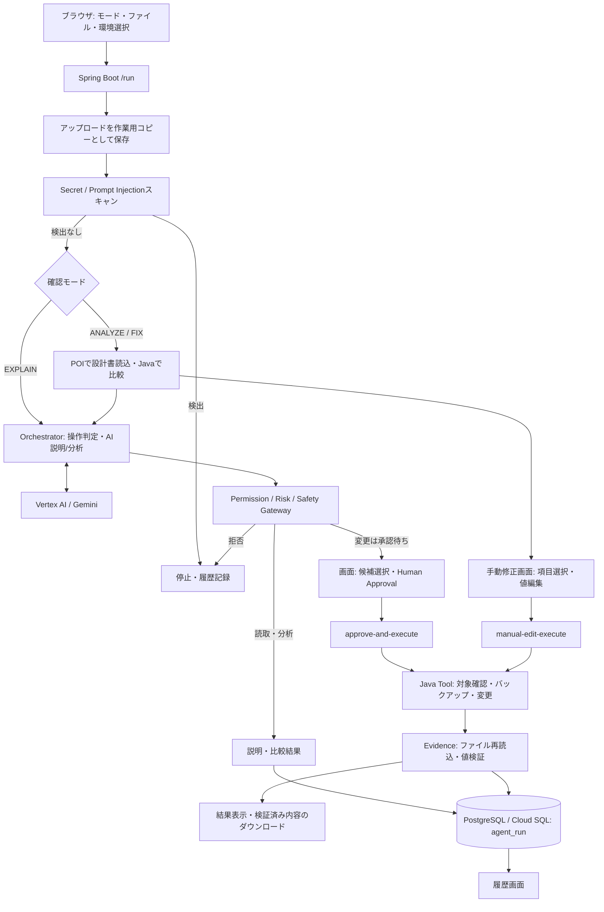

# SafeAgent アーキテクチャ

提出版の実装に基づく構成図です。図の対象はブラウザからの主要フローです。

## 処理フロー

Safety Gatewayは初期の読取・分析操作にも適用されます。このフロー図では分岐を読みやすくするために主要な判定を一つのノードにまとめています。処理の各段階でAuditServiceが操作ログを出力します。

## 責務と境界

| 構成要素 | 責務 |
| --- | --- |
| Browser | ファイル選択、モード選択、候補確認、承認、結果・履歴表示 |
| Orchestrator Controller / Service | 処理順序と結果を管理 |
| ConfigDesign / ConfigComparison | XLSXの対象ファイル・環境別設計値を読込、設定値と比較 |
| GeminiService | Vertex AI経由の説明・分析・提案生成 |
| Permission / Risk / Safety Gateway | AIの操作をJavaのルールで許可・承認要求・拒否 |
| ToolExecutionService | 作業用ファイルの対象位置を確認して変更 |
| EvidenceValidatorService | 変更結果を実ファイルの値で検証 |
| AuditService / RunHistoryService | ログ出力、agent_runの保存・更新・検索 |

AIはファイル変更を直接実行しません。AIの出力と設計書比較結果は別の情報であり、人が変更値を確認します。手動修正はユーザーの項目選択・実行操作からToolにつながる別経路です。

変更対象はCloud Run内の一時ディレクトリに置いたコピーです。利用者PCの元ファイルや稼働サーバーの設定には直接書き込みません。永続保存する実行履歴はCloud SQL、操作ログはアプリケーションログです。

## 図のファイル

- `architecture.svg`: READMEで表示する構成図。拡大しても文字が劣化しないSVG形式。
- `architecture.png`: 提出フォームやスライドに貼り付ける画像（1440 × 940）。
- `architecture.mmd`: システム構成のMermaidソース。
- 本文内のMermaid: モード別の詳細フロー。

認証、承認候補と実行要求の厳密な照合、作業ファイルの自動削除などの未実装事項は[README](../README.md)に記載しています。
